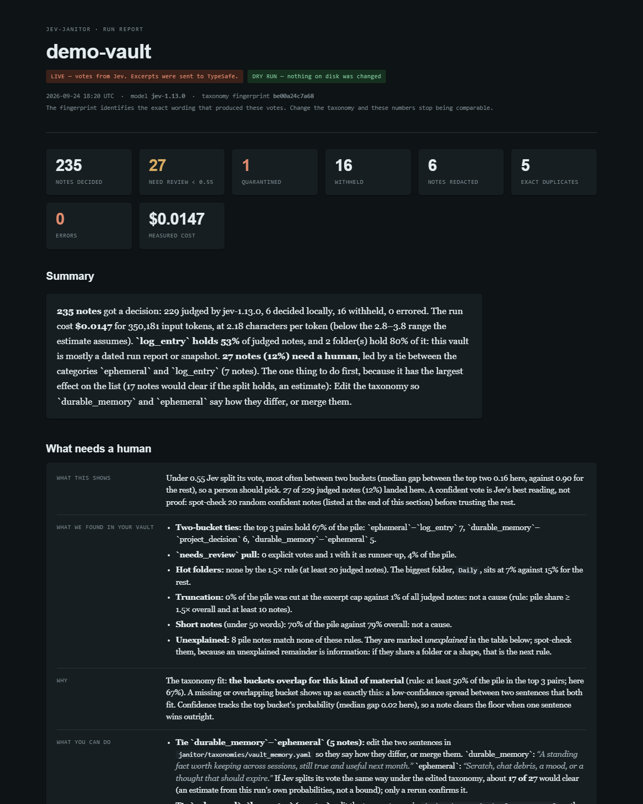

# Jev the Janitor [](https://github.com/kylehovance-ai/jev-the-janitor/actions/workflows/ci.yml)


A janitor for markdown vaults. It asks [TypeSafe Jev](https://typesafe.ai) which bucket each note belongs in. It never deletes a note and never rewrites a note's body; the most it does is add a block of frontmatter or move a suspected secret to a quarantine folder.

**Privacy first.** Each note is redacted on your machine (best-effort, format by format) before anything is sent; `--offline --show-payload` prints exactly what would leave, for free; the bill is shown before the first request; and it never deletes a note.

This project is not affiliated with, endorsed by, or supported by TypeSafe. It calls their public API.

## See a brain scan



That is the card a live scan wrote for [`examples/demo-vault`](examples/demo-vault): a fictional, self-authored second brain of 250 notes, 251 files with the vault's own README, which the scan reads too (daily notes over three years, a greenhouse build, a sourdough log, a home network, a novel draft, reading notes, an archive with duplicates, an inbox and a personal folder). The full page is [`examples/demo-vault-run/report.html`](examples/demo-vault-run/report.html) and the rows it was rendered from are [`run.json`](examples/demo-vault-run/run.json) beside it; a card lists each note's vault-relative path, and this one names nothing but the demo.

**What the live run measured** (2026-09-24, `jev-1.13.0`, taxonomy `be00a24c7a68`): 229 of 251 notes sent, 6 decided locally, 16 withheld; 350,181 input tokens at 2.18 characters per token, **$0.0147**. The pre-flight had estimated $0.0084 to $0.0114 on the 3.8-to-2.8 range, so the bill came in 29% over the pessimistic end: short notes with dates, numbers and links tokenize more densely than prose, and this vault is mostly those. 27 notes (12%) went to the review pile. In 26 of them neither of the top two buckets was `needs_review`; the commonest pairs were `ephemeral` against `log_entry` (7 notes), `durable_memory` against `project_decision` (6) and `durable_memory` against `ephemeral` (5). In the 27th, `needs_review` was the runner-up, and no pile note voted `needs_review`. One note was quarantined for the fake database password planted in it; the checklist's first action is a taxonomy edit. Nothing in the vault is real, so the card is safe to look at.

Reproduce it offline, for free, in under a minute (the votes are the keyword fixture's, and the header says so):

```bash
jev-janitor examples/demo-vault --offline --html demo-card.html
```

Or live, with a key, for under two cents:

```bash
jev-janitor examples/demo-vault --plan            # the estimate first; nothing is sent
jev-janitor examples/demo-vault --json --html demo-card.html > demo-run.json
```

## Quick start

Offline first. This uses a keyword stand-in instead of Jev, needs no key, and sends nothing anywhere:

```bash
git clone https://github.com/kylehovance-ai/jev-the-janitor.git
cd jev-the-janitor
pip install -e ".[dev]"
pytest -q
jev-janitor ./fixtures/notes --offline
```

Then live. `--plan` shows what would be sent without sending it:

```bash
pip install -e ".[jev]"           # adds typesafe-sdk
export TYPESAFE_API_KEY=...       # from TypeSafe
jev-janitor ./fixtures/notes --plan
jev-janitor ./fixtures/notes --json
```

Dry run is the default. Nothing is written until you pass `--apply`.

```bash
# Write janitor.* frontmatter onto each note; move suspected secrets to _janitor/quarantine/
jev-janitor ./vault --apply

# Your own sensitive folder names (replaces the default list; matched as whole words of a folder name)
jev-janitor ./vault --sensitive-paths family,private,_inbox,clients

# Strip names or terms locally before anything is sent
jev-janitor ./vault --denylist ./my-denylist.txt
```

Full usage:

```
jev-janitor PATH [--plan] [--apply] [--offline] [--yes] [--include-sensitive]
                 [--sensitive-paths a,b,c] [--denylist FILE]
                 [--taxonomy FILE] [--model jev-latest] [--json] [--show-payload]
                 [--git-unsafe-below P]
                 [--journal default|vault|off|DIR] [--resume [JOURNAL]] [--no-cache]
                 [--workers N] [--excerpt-chars N|full] [--journal-info] [--quiet]
                 [--no-local-triage] [--max-usd USD] [--over-budget]
                 [--config FILE] [--no-config] [--review-pile FILE] [--diff [JOURNAL]] [--survey [N]] [--map FILE]
```

`python -m janitor.cli` works the same way without installing the script. Requires Python 3.11+.

## How it works

**What Jev is.** Jev is a "System One" model from TypeSafe: instead of generating text, it takes a piece of state and a set of typed questions and returns typed answers with calibrated probabilities. A `Choice` picks one of your options, a `Score` places the state on your rubric, a `Noul` is the probability a statement is true. It cannot emit prose, so it cannot invent a folder name or "improve" a sentence. This tool uses that as a traffic light for tidying notes.

**Who this is for.** Anyone with a folder of `.md` files that has grown past what they can hand-sort: Obsidian vaults, wikis, the notes directory a team of tools keeps dumping into. Nothing here depends on Obsidian.

**Does it work.** Yes, with limits stated below. It has been run against live Jev on an invented fixture vault, on the 250-note demo vault in `examples/`, on 26 real notes from one production vault, and, in September 2026 on a 0.4.x release, on one full real vault of 25,107 notes: 17,140 judged by Jev, 1,742 decided locally, 6,216 withheld and 9 refused by the API, for $2.51 in 4 min 56 s at 16 workers. Those figures are stated here; the demo vault's card is [on this page](#see-a-brain-scan), the 26-note study is in the [calibration notes](docs/calibration.md), the invented fixture's labels are in the [fixture demo](docs/fixture-demo.md), and the 25,107-note run's characters per token and its bill against the estimate are in [the pre-flight section](docs/privacy-contract.md#pre-flight-see-the-membrane-before-you-cross-it) of the privacy contract. It has not been calibrated on anyone else's vault. Expect to edit the taxonomy after your first dry run.

```
note excerpt (redacted locally)
        +
seven typed questions: bucket, persist, secret, duplicate, decision, actionable, git-safe
        ->
Jev (System One)
        ->
typed vote with probabilities
        ->
dry-run report  |  --apply: frontmatter, or quarantine
```

Jev votes. Your code files. You review the low-confidence pile.

## Documentation

- [The privacy contract](docs/privacy-contract.md): what leaves the machine and what never does, sensitive paths, redaction, the pre-flight and its bill, and what `--apply` guarantees.
- [What Jev sees](docs/what-jev-sees.md): the seven fields of the state sent per note, the defaults, the questions, and a real example from the demo vault.
- [The run journal](docs/run-journal.md): progress, failed notes, where the journal lives, `--resume` and the cache, and workers.
- [A vault profile](docs/vault-profile.md): `janitor.toml`, the settings a scheduled scan reads instead of flags.
- [Local triage](docs/local-triage.md): what code decides before anything is sent, findings, the brain-scan report, the review pile and the lock.
- [Survey and diff](docs/survey-and-diff.md): `--survey` for a stratified sample first, and `--diff` for what moved between two scans.
- [Records](docs/records.md): `jev-records`, the same judge for a JSONL file of records instead of a vault.
- [The brain map](docs/brain-map.md): the `--map` data layer, per-folder rollups and graph facts as JSON.
- [What Jev is asked](docs/what-jev-is-asked.md): the taxonomy file, its bucket choice, persist score and five nouls, how the questions are sent, and the measured API limits.
- [Fixture demo](docs/fixture-demo.md): the invented fixture vault, offline labels against live Jev's.
- [Calibration notes](docs/calibration.md): what was measured on live Jev, and what it taught about wording.

## Limitations

- **The offline client is not Jev.** Keyword rules for CI and demos. Its labels are wrong on real notes.
- **Calibrated on one vault.** The taxonomy was tuned against 26 notes from one production vault plus invented fixtures. Your notes will disagree with some votes. Edit the YAML, re-run, compare fingerprints.
- **Duplicate detection is titles plus a content hash, not semantics.** Sibling titles go to Jev; identical content is hashed locally. Two notes that say the same thing in different words are not caught.
- **The default excerpt is the first 16,000 characters** (1,200 before 0.2.1). On a real 18,712-note vault that reads 93.6% of notes in full, against 17% at 1,200, and uses about a fifth of the API's 32,768-token ceiling. Notes longer than the cap are still judged on their opening, so a very long note with a preamble can still be misread; `--excerpt-chars full` sends whole notes up to the 60,000-character guard. Changing the cap changes the cache key of every note longer than the smaller cap, so a resume at a different cap re-sends exactly those notes.
- **Large vaults.** Sequential is about a quarter of a second per note, so pass `--workers`. Progress is visible, every finished note is on disk as it completes, one failed note never discards the run, and `--resume` continues an interrupted run without re-sending what is done, an `--apply` run included: a stamp does not change a note's cache key, because the tool's own key name is not sent and an undated note's age is read from the date the stamp recorded (`janitor.created_from_mtime`, the file's mtime before the janitor's first write) rather than from the mtime the write moved; the file's mtime itself is left at the write, so sync clients see the change (through 0.5.1 an undated note's age band moved with the stamp and `--resume` after `--apply` re-sent it; a note stamped by 0.5.0 or 0.5.1 carries no recorded date, keeps the key it has, and gets the date on its next re-stamp) (under `--apply`, a note's file is stamped or moved by the one writer thread right before its row is recorded, never by a worker, so a Ctrl-C leaves at most one stamped note without a row, the one it landed on; through 0.4.7, since 0.4.6, workers wrote their own files ahead of the writer, so an interrupt inside the writer could leave several stamped or moved notes with no row, which `--resume` then re-sent). The prepare phase reads every note before the first request, which on a 20,000-note vault is some seconds of local I/O with no progress line yet.
- **The cache is the journal.** Nothing is served unless `--resume` is passed; a plain run re-sends every note. At $0.042 per million input tokens a 26-note run cost well under a tenth of a cent, so this is a correctness limitation more than a cost one.
- **Regex redaction misses things regexes miss, and over-redacts things that look like what it hunts.** A card number is replaced only when it passes Luhn, has a card's grouping and starts with a payment network's digit (2 to 6); a 16-digit string that fails any of those stays in the excerpt. The residual the other way: a contiguous 13-to-19-digit run that starts 2 to 6 and happens to pass Luhn still becomes `[CARD]`, which is about one millisecond timestamp beginning `2026...` in ten. That is inherent to regex redaction; the number is stated so it is known rather than discovered.
- **Not affiliated with, endorsed by, or supported by TypeSafe.** It calls their public API.

## Development

```bash
pip install -e ".[dev,jev]"
pytest -q
```

The suite runs without `TYPESAFE_API_KEY`. One test replays a recorded live response through the SDK's own response model and skips if the SDK is not installed. CI runs on Linux and Windows, Python 3.11 and 3.12, plus one leg that installs `.[dev]` alone with no SDK, which is the path this README documents.

MIT. Copyright (c) 2026 Vanced Corporation. Built and maintained by Kyle Hovance.
